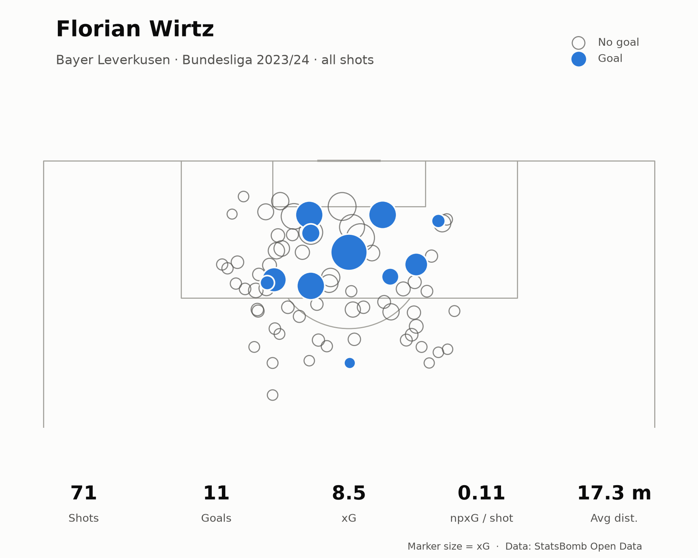
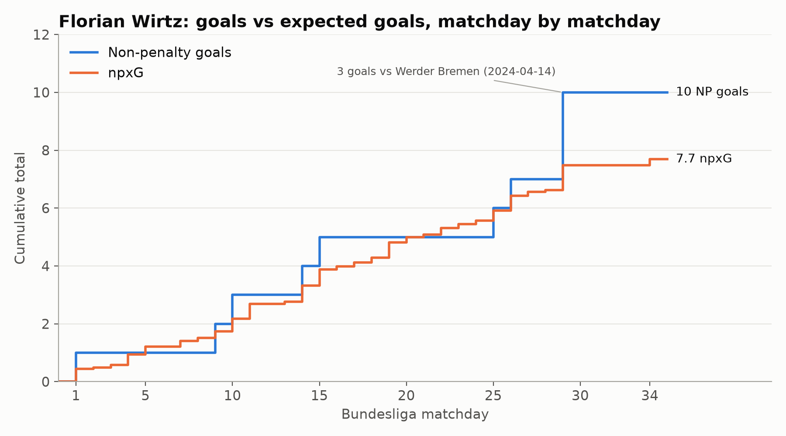
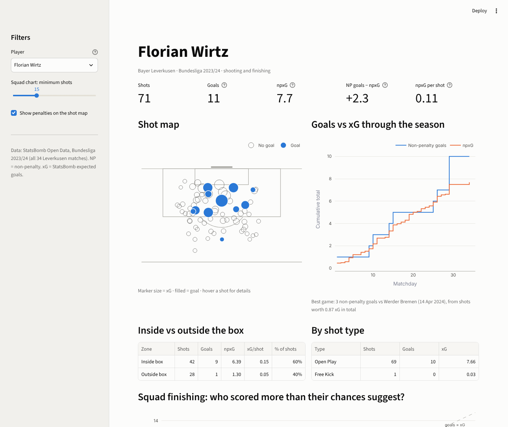

# Shot maps and expected goals: Bayer Leverkusen 2023/24

Leverkusen went the entire 2023/24 Bundesliga season unbeaten. This project uses free
StatsBomb event data to look at **who took their shots, from where, and whether they
finished better or worse than the quality of their chances suggests**, with
Florian Wirtz as the main case study.

It's the first project in a football analytics portfolio series, covering
**SQL on football event data (DuckDB)**, expected goals (xG), basic statistical testing,
and clear football visualisation.



## Questions

1. Where does Florian Wirtz shoot from, and how good are his chances?
2. Did he score more or fewer goals than his xG suggests, and was that steady across the season or driven by a few games?
3. How does his finishing compare with the rest of the Leverkusen squad?

## Data

- **Source:** [StatsBomb Open Data](https://github.com/statsbomb/open-data), Bundesliga 2023/24
  (competition 9, season 281). All 34 Leverkusen matches are included, with 916 shots in total
  (623 by Leverkusen).
- **xG:** StatsBomb's own model (`shot_statsbomb_xg`), which uses shot location, body part,
  type of play and the positions of the goalkeeper and defenders at the moment of the shot.
- **Penalties** are excluded from "non-penalty" (NP) metrics. A penalty is worth ~0.78 xG and says
  little about a player's finishing.
- Pitch coordinates are StatsBomb's 120 × 80 yard grid. Distances are converted to metres.

## How it's built: SQL first

The raw data is loaded into a **DuckDB** database (`data/statsbomb.duckdb`) with two tables,
`matches` and `shots`. **Every number in this README is a SQL query** in [`sql/`](sql/).
Python only downloads the data and draws the charts.

| Query | What it does | SQL used |
|---|---|---|
| `01_shot_features` | Joins shots to matches; adds goal/penalty/box flags, distance and shot angle | `JOIN`, `CASE`, trig functions |
| `03_player_summary` | Shots, goals, xG, npxG, xG/shot, distance, % on target | `FILTER` aggregates |
| `04_player_zones` | Inside vs outside the box | `GROUP BY`, window share-of-total |
| `05_cumulative_by_matchday` | Running goals vs xG over all 34 matchdays | CTEs, `LEFT JOIN`, `ROW_NUMBER`, running `SUM() OVER` |
| `06_squad_finishing` | Goals − xG, standard deviation and z-score per player | CTE, `RANK() OVER` |
| `07_xg_calibration` | Mean xG vs actual conversion by distance band | `CASE` bucketing |
| `08_shot_type_breakdown`, `09_best_single_match` | Free kicks vs open play; best scoring game | `GROUP BY`, `ORDER BY ... LIMIT` |
| `10_tableau_shots` | Flat shot table with Leverkusen matchday numbers for Tableau | CTE, `ROW_NUMBER`, type casts |

For example, the luck check from finding 3 is a single query:

```sql
WITH per_player AS (
    SELECT player,
           count(*)                        AS shots,
           count(*) FILTER (WHERE is_goal) AS np_goals,
           sum(xg)                         AS npxg,
           sqrt(sum(xg * (1 - xg)))        AS sd      -- each shot ~ Bernoulli(xG)
    FROM shot_features
    WHERE team = $team AND NOT is_penalty
    GROUP BY player
)
SELECT player, shots, np_goals, npxg,
       np_goals - npxg                         AS goals_minus_xg,
       (np_goals - npxg) / sd                  AS z_score,
       rank() OVER (ORDER BY np_goals - npxg DESC) AS overperformance_rank
FROM per_player
WHERE shots >= $min_shots
ORDER BY npxg DESC;
```

## Key findings

**1. Wirtz shoots a lot from outside the box, but scores from inside it.**
Of his 70 non-penalty shots, 28 (40%) came from outside the box. Those produced just
1 goal from 1.3 xG. The 42 shots inside the box produced 9 goals from 6.4 xG.
His average chance is worth 0.11 npxG per shot, typical for an attacking midfielder
and well below a central striker like Boniface (0.17).

**2. His overperformance is real but small, and comes mostly from one afternoon.**
Wirtz scored 10 non-penalty goals from 7.7 npxG (+2.3). For most of the season his goals
tracked his xG closely. The gap opened on matchday 29, when he scored 3 times in the
5–0 win over Werder Bremen from chances worth only ~0.77 xG combined. That was the
game in which Leverkusen clinched the title.



**3. Across the squad, finishing evens out, with one surprise.**


| Player | Shots | NP goals | npxG | Goals − xG |
|---|---:|---:|---:|---:|
| Victor Boniface | 77 | 10 | 12.8 | −2.8 |
| Jeremie Frimpong | 56 | 9 | 8.7 | +0.3 |
| **Florian Wirtz** | 70 | 10 | 7.7 | **+2.3** |
| Jonas Hofmann | 62 | 4 | 5.7 | −1.7 |
| Alejandro Grimaldo | 71 | 10 | 5.2 | **+4.8** |
| Patrik Schick | 39 | 6 | 4.7 | +1.3 |

- **Grimaldo, a left-back, scored as many non-penalty goals as Wirtz and Boniface from
  under half the xG.** Only 2 of his goals came from direct free kicks (from 0.9 xG).
  Most of the overperformance came in open play: 8 goals from 4.3 xG.
- **Boniface got the best chances in the squad** (12.8 npxG, 64 of 77 shots inside the box)
  but finished below expectation.
- **How much is luck?** If every shot is treated as an independent coin flip with
  probability = its xG, the standard deviation of goals is √Σ xG(1 − xG). For Wirtz
  that's ±2.4 goals, so his +2.3 is about 1 standard deviation, within normal variation.
  Boniface's −2.8 is also about −1 SD. Grimaldo's +4.8 is **2.4 SD**, unusual enough to be
  worth a closer look but not proof of elite finishing from one season. Expect some
  regression toward xG.

## Dashboards

### Interactive Streamlit app

Pick any Leverkusen player and get their KPIs, an interactive shot map (hover any shot for opponent,
minute, xG and outcome), goals vs xG through the season, box and shot-type breakdowns, and the squad
finishing chart with z-scores. Every number comes from the same SQL queries.



```bash
streamlit run app.py
```

### Tableau

[`tableau/`](tableau/) contains a Tableau-ready shots file (exported by `sql/10_tableau_shots.sql`),
a pitch background image with exact coordinates, and a [step-by-step build guide](tableau/TABLEAU_GUIDE.md)
covering calculated fields, parameters, a running-total table calculation and a dashboard layout.

## Project structure

```
├── app.py                 # Streamlit dashboard
├── run.py                 # generate all figures + summary tables for any player
├── sql/                   # all analysis logic, one query per file (01-10)
├── src/
│   ├── database.py        # download StatsBomb data into DuckDB (matches, shots tables)
│   ├── queries.py         # runs sql/*.sql with named parameters -> DataFrames
│   ├── plots.py           # static charts for the README (matplotlib/mplsoccer)
│   ├── interactive.py     # interactive charts for the dashboard (Plotly)
│   └── export_tableau.py  # writes the Tableau CSV + pitch image
├── tableau/               # Tableau data, pitch background, build guide
├── notebooks/
│   └── 01_shot_analysis.ipynb   # walkthrough showing each query and its result
├── data/
│   └── statsbomb.duckdb   # the database (0.8 MB, included so it runs offline)
└── figures/
```

## How to run

```bash
pip install -r requirements.txt
python run.py                                   # Florian Wirtz (default)
python run.py --player "Victor Okoh Boniface"   # any Leverkusen player
streamlit run app.py                            # interactive dashboard
python -m src.export_tableau                    # regenerate the Tableau files
```

Requires Python 3.10+. The database is included. Run `python run.py --rebuild` to re-download all
34 matches from StatsBomb's GitHub (about a minute). If you mistype a name, the script lists every
player available.

You can also query the database directly, from Python or the [DuckDB CLI](https://duckdb.org/docs/installation/):

```python
import duckdb
con = duckdb.connect("data/statsbomb.duckdb", read_only=True)
con.sql(open("sql/01_shot_features.sql").read())          # create the shot_features view
con.sql("SELECT player, count(*) AS shots, sum(xg) AS xg FROM shot_features "
        "WHERE team = 'Bayer Leverkusen' GROUP BY player ORDER BY xg DESC LIMIT 5")
```

## Limitations and next steps

- StatsBomb only released **Leverkusen's** 34 matches for this season, so the comparison is
  within one squad, not the whole league.
- xG measures chance quality *before* the shot is struck, not the shot's placement.
  Post-shot xG would separate good finishing from good goalkeeping.
- **Next:** build my own xG model from the same data and compare it to StatsBomb's
  (Project 4 in this series).

---
Data: [StatsBomb Open Data](https://github.com/statsbomb/open-data). Built with
[DuckDB](https://duckdb.org), [`statsbombpy`](https://github.com/statsbomb/statsbombpy) and [`mplsoccer`](https://mplsoccer.readthedocs.io).
