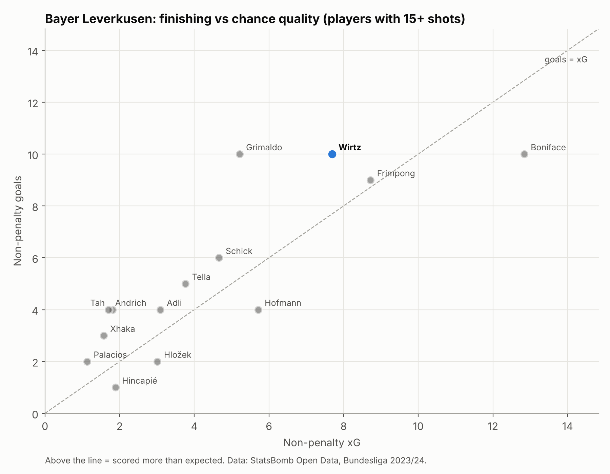

# Shot maps and expected goals: Bayer Leverkusen 2023/24

Leverkusen went the entire 2023/24 Bundesliga season unbeaten. This project uses free
StatsBomb event data to look at **who took their shots, from where, and whether they
finished better or worse than the quality of their chances suggests**, with
Florian Wirtz as the main case study.

It's the first project in a football analytics portfolio series, covering
event-data parsing, expected goals (xG), and clear football visualisation.


## Questions

1. Where does Florian Wirtz shoot from, and how good are his chances?
2. Did he score more or fewer goals than his xG suggests, and was that steady across the season or driven by a few games?
3. How does his finishing compare with the rest of the Leverkusen squad?

## Data

- **Source:** [StatsBomb Open Data](https://github.com/statsbomb/open-data), Bundesliga 2023/24
  (competition 9, season 281). All 34 Leverkusen matches are included, with 916 shots in total
  (623 by Leverkusen).
- **xG:** StatsBomb's own model (`shot_statsbomb_xg`), which uses shot location, body part,
  type of play and the positions of the goalkeeper and defenders at the moment of the shot.
- **Penalties** are excluded from "non-penalty" (NP) metrics. A penalty is worth ~0.78 xG and says
  little about a player's finishing.
- Pitch coordinates are StatsBomb's 120 × 80 yard grid. Distances are converted to metres.

## Key findings

**1. Wirtz shoots a lot from outside the box, but scores from inside it.**
Of his 70 non-penalty shots, 28 (40%) came from outside the box. Those produced just
1 goal from 1.3 xG. The 42 shots inside the box produced 9 goals from 6.4 xG.
His average chance is worth 0.11 npxG per shot, typical for an attacking midfielder
and well below a central striker like Boniface (0.17).

**2. His overperformance is real but small, and comes mostly from one afternoon.**
Wirtz scored 10 non-penalty goals from 7.7 npxG (+2.3). For most of the season his goals
tracked his xG closely. The gap opened on matchday 29, when he scored 3 times in the
5–0 win over Werder Bremen from chances worth only ~0.77 xG combined. That was the
game in which Leverkusen clinched the title.


**3. Across the squad, finishing evens out, with one surprise.**



| Player | Shots | NP goals | npxG | Goals − xG |
|---|---:|---:|---:|---:|
| Victor Boniface | 77 | 10 | 12.8 | −2.8 |
| Jeremie Frimpong | 56 | 9 | 8.7 | +0.3 |
| **Florian Wirtz** | 70 | 10 | 7.7 | **+2.3** |
| Jonas Hofmann | 62 | 4 | 5.7 | −1.7 |
| Alejandro Grimaldo | 71 | 10 | 5.2 | **+4.8** |
| Patrik Schick | 39 | 6 | 4.7 | +1.3 |

- **Grimaldo, a left-back, scored as many non-penalty goals as Wirtz and Boniface from
  under half the xG.** Only 2 of his goals came from direct free kicks (from 0.9 xG).
  Most of the overperformance came in open play: 8 goals from 4.3 xG.
- **Boniface got the best chances in the squad** (12.8 npxG, 64 of 77 shots inside the box)
  but finished below expectation.
- **How much is luck?** If every shot is treated as an independent coin flip with
  probability = its xG, the standard deviation of goals is √Σ xG(1 − xG). For Wirtz
  that's ±2.4 goals, so his +2.3 is about 1 standard deviation, within normal variation.
  Boniface's −2.8 is also about −1 SD. Grimaldo's +4.8 is **2.4 SD**, unusual enough to be
  worth a closer look but not proof of elite finishing from one season. Expect some
  regression toward xG.

## Project structure

```
├── run.py                 # generate all figures + summary tables for any player
├── src/
│   ├── data.py            # download/cache StatsBomb shots, feature engineering
│   └── plots.py           # shot map, cumulative xG, squad comparison
├── notebooks/
│   └── 01_shot_analysis.ipynb   # walkthrough with the analysis above
├── data/                  # cached shot data (included, so it runs offline)
└── figures/
```

## How to run

```bash
pip install -r requirements.txt
python run.py                                   # Florian Wirtz (default)
python run.py --player "Victor Okoh Boniface"   # any Leverkusen player
```

Requires Python 3.10+. The shots are cached in `data/`. Delete that file to re-download all 34
matches from StatsBomb's GitHub (about a minute). If you mistype a name, the script lists every
player available.

## Limitations and next steps

- StatsBomb only released **Leverkusen's** 34 matches for this season, so the comparison is
  within one squad, not the whole league.
- xG measures chance quality *before* the shot is struck, not the shot's placement.
  Post-shot xG would separate good finishing from good goalkeeping.
- **Next:** build my own xG model from the same data and compare it to StatsBomb's
  (Project 4 in this series).

---
Data: [StatsBomb Open Data](https://github.com/statsbomb/open-data). Built with
[`statsbombpy`](https://github.com/statsbomb/statsbombpy) and [`mplsoccer`](https://mplsoccer.readthedocs.io).
